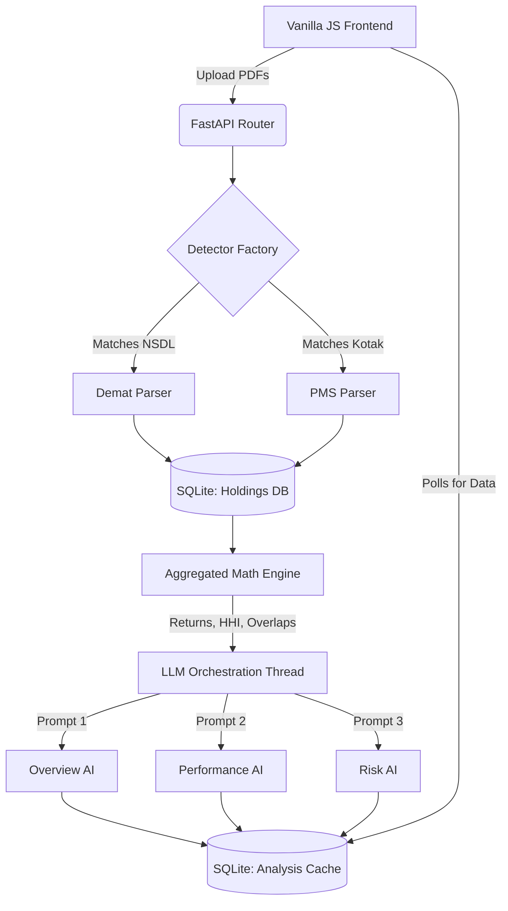

# VIKABH — Wealth Intelligence 📊🤖


**VIKABH** is an enterprise-grade, AI-powered portfolio analytics and wealth intelligence platform. 

It solves the notoriously difficult problem of unstructured financial data by deterministically parsing raw PDF statements (Demat, PMS, Mutual Funds), calculating true mathematical performance metrics, and orchestrating targeted Generative AI (LLMs) to write bespoke financial narratives, risk alerts, and performance summaries.

All of this is wrapped in a lightning-fast, zero-dependency Single Page Application (SPA) dashboard.

---

## ✨ Core Features

### 1. Intelligent PDF Extraction
* **Factory Pattern Architecture:** Financial institutions frequently change their statement formats. VIKABH uses a `detector.py` factory pattern to identify the broker (e.g., Kotak, HDFC, Enam) and route the PDF to an isolated, specialized parser. 
* **Zero-Hallucination Parsing:** Instead of relying on LLMs to read tables (which causes quantity hallucinations), PyMuPDF deterministically tracks vertical layouts and Regex blocks to extract 100% accurate quantities, buy prices, and current values.

### 2. Multi-Account Aggregation (Family Office View)
* Upload multiple distinct accounts (e.g., Wife's Demat, Husband's PMS) to a single Client profile.
* The system mathematically calculates both **Account-Level** metrics and **Consolidated Family-Level** metrics.
* **Instant Pivoting:** Use the dashboard dropdown to seamlessly toggle between the aggregated Family view and isolated individual accounts without reloading the page.

### 3. Targeted LLM Orchestration
To prevent LLM degradation from massive prompt context, VIKABH splits the AI reasoning into four isolated, parallel calls per account:
* **Overview AI:** High-level asset allocation and health narratives.
* **Performance AI:** Deep dive into top winners and worst drags.
* **Risk AI:** Analyzes HHI (Herfindahl-Hirschman Index) concentration and cross-account overlaps.
* **Insights AI:** Generates actionable 3-4 bullet alerts (Danger, Warning, Success).

### 4. Zero-Latency Dashboard
LLMs take 15-20 seconds to run. The FastAPI backend orchestrates uploads sequentially and runs the LLM calls in a background thread, saving the outputs to an `AnalysisCache` SQLite table. The Vanilla JS frontend polls this state and loads instantly once the cache is populated.

### 5. Screener.in Market Data Enrichment
Statements are a snapshot of one date. Loading a **Screener.in CSV export** marks every matched holding to its live price and attaches sector, market-cap tier and fundamentals (P/E, ROE, ROCE, debt/equity, dividend yield, growth).

* **No API, by design:** Screener.in does not offer a public API. The premium **Export** button produces a CSV, and that is what the app ingests — no credentials are stored and nothing breaks when Screener changes its HTML.
* **Format-tolerant ingestion:** you choose up to 50 columns in Screener, so column names are matched by rule rather than position. Any preamble rows are skipped, unrecognised columns are preserved verbatim in `extras_json`, and the import response lists exactly what was recognised and ignored.
* **Conservative matching:** holdings join to market data by ISIN first, then exchange code, then a normalised company name. A name that two companies share is reported as unmatched rather than guessed at.
* **Honest partial figures:** a holding is revalued only when both a price *and* a share quantity are known. The API returns `live_value_partial` with `priced_holdings` alongside it, and the UI labels it as a partial figure rather than presenting it as a portfolio total.

---

## 🏗️ System Architecture



---

## ⚙️ Installation & Setup

### 1. Clone the Repository
```bash
git clone https://github.com/ritanshubirla-07/wealth-management.git
cd wealth-management
```

### 2. Set Up the Virtual Environment
Ensure you have Python 3.11+ installed.
```bash
python -m venv .venv

# Windows (PowerShell)
.\.venv\Scripts\Activate.ps1
# Mac/Linux
source .venv/bin/activate

pip install -r requirements.txt
```

### 3. Configure the Environment (.env)
Create a `.env` file in the root directory. You can use any OpenAI-compatible endpoint (OpenAI, Groq, Scaleway, Cerebras, local vLLM).

```ini
# Example for OpenAI
OPENAI_API_KEY=sk-your-openai-key

# Example for Custom Provider (e.g., Scaleway / LLaMA 3)
LLM_BASE_URL=https://api.scaleway.ai/v1/chat/completions
LLM_API_KEYS=your-api-key-here
LLM_MODEL=llama-3.3-70b-instruct
```

### 4. Boot the Server
Start the FastAPI server. The SQLite database (`VIKABH.db`) will automatically initialize on startup.
```bash
python -m uvicorn app.main:app --host 127.0.0.1 --port 8000 --reload
```

---

## 🖥️ User Workflow

1. **Client Directory:** Open `http://localhost:8000/`. You will land on the Client Directory. Click **"New Client"** to create a family profile.
2. **Staging Area:** Click on the newly created client card to open `upload.html`. Drag and drop all relevant Demat and PMS PDF statements into the drop-zone.
3. **Sequential Uploading:** Click **"Analyze Portfolio"**. The frontend sequentially queues the files to prevent database locks, triggering the LLM engine only on the final file.
4. **AI Generation Spinner:** A loading spinner will appear for ~15 seconds while the backend crunches the raw math and queries the LLM API.
5. **Dynamic Dashboard:** Once the AI finishes, you are instantly redirected to `dashboard.html`. Here, you can navigate between Portfolio, Performance, Risk, and Insights tabs. 
6. **Account Toggling:** Use the top-right dropdown to instantly pivot the dashboard from the Aggregated Family View to specific individual accounts.

---

## 📈 Loading Screener.in Market Data

Market data is shared across every client, so it is loaded once from the home page rather than per client.

### 1. Export from Screener
1. Open any screen on [screener.in](https://www.screener.in/) — to cover a whole portfolio, a query as broad as `Market Capitalization > 0` works.
2. Use **edit columns** to include at least **Name**, **NSE Code**, **Industry** and **CMP**. Add whatever else you want surfaced: **Mar Cap**, **P/E**, **ROE %**, **ROCE %**, **Debt / Eq**, **Div Yld %**, **Qtr Sales Var %**, **Qtr Profit Var %**.
3. Click **Export** (premium only) to download the CSV.

### 2. Load it
On `http://localhost:8000/`, use the **Screener.in market data** panel: choose the CSV and click **Import CSV**. The result panel reports how many securities loaded and which columns were recognised or ignored — check this first if a dashboard column comes out empty.

Equivalent API call:
```bash
curl -X POST http://localhost:8000/api/market/import -F "file=@screener_export.csv"
```

### Alternative: fetch CMP automatically
`scripts/fetch_cmp.py` pulls the current price for every stock you hold straight from Screener's public company pages, so prices can be refreshed without a manual export.

```bash
python -m scripts.fetch_cmp                  # every holding in the database
python -m scripts.fetch_cmp --client 17      # one client
python -m scripts.fetch_cmp --dry-run        # resolve symbols, fetch nothing
python -m scripts.fetch_cmp --max-age 30     # skip anything priced in the last 30 min
python -m scripts.fetch_cmp --delay 3        # be gentler (default 2s between requests)
```

How it stays well-behaved:

* **Public pages only** — it requests `/company/<CODE>/` and nothing else. No login, no session cookie, no premium credentials, so a scraping mistake cannot expose or burn your account.
* **robots.txt is enforced in code.** Screener disallows `/*?q=` (its search endpoint), `/*?sort=`, `/*?limit=`, `/*?page=`, `/user/*` and `/company/source/quarter/*`. Every URL is checked with `urllib.robotparser` before it is fetched, and the run aborts if robots.txt cannot be read at all.
* **Symbols come from NSE, not Screener search.** Because search is disallowed, ISIN → ticker resolution uses [NSE's published equity master](https://nsearchives.nseindia.com/content/equities/EQUITY_L.csv), cached in `data/` and refreshed weekly. Your demat statements already carry ISINs.
* **One request at a time, spaced out.** No concurrency, a configurable delay, exponential backoff, and `Retry-After` respected on HTTP 429/503.
* **A failure never becomes a number.** If `Current Price` cannot be found the security is reported as failed and the old price is left untouched — a parse break can never silently write a wrong or zero price.
* **Duplicate work is skipped.** One page fetch per security even when it is held in several accounts, and `--max-age` avoids refetching recent prices.

Resolution is imperfect by nature: mutual funds, bonds, delisted names and cash lines have no Screener equity page, and the run lists each one with the reason. Prices on the page are shown to Screener's own precision (whole rupees for large caps, decimals for small ones), so a market value can differ from a broker's by a fraction of a percent.

### 3. Check coverage
```bash
curl "http://localhost:8000/api/market/coverage/<client_id>"
```
This lists which holdings matched and how (`isin`, `code` or `name`) plus every holding that did not, so you can see what needs a broader export.

### Endpoints
| Endpoint | Purpose |
|---|---|
| `POST /api/market/import` | Ingest a Screener CSV. `?replace=false` merges instead of replacing the universe. |
| `GET /api/market/status` | Universe size, source file and import timestamp. |
| `GET /api/market/coverage/{client_id}` | Per-holding match report, including unmatched holdings. |

### Things worth knowing
* **Prices are as fresh as your last export.** Nothing refreshes automatically; `GET /api/market/status` reports the timestamp and the home page shows it.
* **Revaluation needs a share quantity.** Demat and PMS statements carry one, so those revalue. Holdings uploaded before this feature existed have no stored quantity and must be re-uploaded to revalue.
* **Market-cap tiers are rank-based.** SEBI/AMFI define large cap as the top 100 companies by market cap, mid as 101–250, small as 251+. Tiers are ranked over *the rows you imported*, so they are only meaningful if the export covered a broad universe — a 25-row screen will label everything "Large Cap".
* **ISIN is the reliable join key.** Demat statements include it and it is stored per holding. PMS and mutual-fund statements usually do not, so those fall back to name matching — which is why the coverage endpoint exists.

---

## 📂 Project Structure

```text
wealth-management/
├── app/
│   ├── main.py              # FastAPI application & static mounting
│   ├── database.py          # SQLite connection and session maker
│   ├── models.py            # SQLAlchemy ORM definitions (Client, Account, Holding, Cache)
│   ├── llm.py               # AI orchestration and prompt engineering
│   ├── market_data.py       # Screener.in CSV parsing + holding matching
│   ├── sector_map.py        # Deterministic sector / market-cap lookup
│   ├── routers/             # API Endpoints (Upload, Overview, Portfolio, Market, etc.)
│   └── parsers/             # Statement extraction logic
│       ├── detector.py      # Format detection, header mapping, holding building
│       └── excel.py         # Spreadsheet statements (delegates to detector)
├── frontend/                # Zero-dependency SPA
│   ├── clients.html         # Client CRUD UI
│   ├── upload.html          # Drag-and-Drop & Polling UI
│   ├── dashboard.html       # Final UI Template
│   └── dashboard.js         # Dynamic DOM manipulation & Chart.js logic
├── .env.example             # Environment templates
└── requirements.txt         # Python dependencies
```
