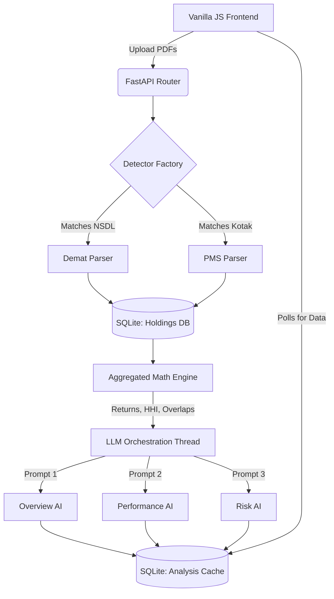

# VIKABH — Wealth Intelligence 📊🤖


**VIKABH** is an enterprise-grade, AI-powered portfolio analytics and wealth intelligence platform. 

It solves the notoriously difficult problem of unstructured financial data by deterministically parsing raw PDF statements (Demat, PMS, Mutual Funds), calculating true mathematical performance metrics, and orchestrating targeted Generative AI (LLMs) to write bespoke financial narratives, risk alerts, and performance summaries.

All of this is wrapped in a lightning-fast, zero-dependency Single Page Application (SPA) dashboard.

---

## ✨ Core Features

### 1. Intelligent PDF Extraction
* **Factory Pattern Architecture:** Financial institutions frequently change their statement formats. VIKABH uses a `detector.py` factory pattern to identify the broker (e.g., Kotak, HDFC, Enam) and route the PDF to an isolated, specialized parser. 
* **Zero-Hallucination Parsing:** Instead of relying on LLMs to read tables (which causes quantity hallucinations), `pdfplumber` deterministically tracks vertical layouts and Regex blocks to extract quantities, buy prices and current values. An LLM is used only to map column headers it has never seen, never to read a number.
* **Aggregate rows are rejected.** A statement's "Net Worth" or "Stocks" subtotal is not a holding. Three independent checks catch them: a zero-quantity test, a whole-label match, and an arithmetic test that spots a row equal to the sum of the rows below it.

### 2. Multi-Account Aggregation (Family Office View)
* Upload multiple distinct accounts (e.g., Wife's Demat, Husband's PMS) to a single Client profile.
* The system mathematically calculates both **Account-Level** metrics and **Consolidated Family-Level** metrics.
* **Instant Pivoting:** Use the dashboard dropdown to seamlessly toggle between the aggregated Family view and isolated individual accounts without reloading the page.

### 3. Targeted LLM Orchestration
To prevent LLM degradation from massive prompt context, VIKABH splits the AI reasoning into four isolated, parallel calls per account:
* **Overview AI:** High-level asset allocation and health narratives.
* **Performance AI:** Deep dive into top winners and worst drags.
* **Risk AI:** Analyzes HHI (Herfindahl-Hirschman Index) concentration and cross-account overlaps.
* **Insights AI:** Generates actionable 3-4 bullet alerts (Danger, Warning, Success).

### 4. Zero-Latency Dashboard
LLMs take 15-20 seconds to run. The FastAPI backend orchestrates uploads sequentially and runs the LLM calls in a background thread, saving the outputs to an `AnalysisCache` SQLite table. The Vanilla JS frontend polls this state and loads instantly once the cache is populated.

### 5. Fundamentals, refreshed nightly
Statements are a snapshot of one date. Company statements are fetched from **Yahoo Finance** (a JSON API, so no HTML parsing to break) with **Screener.in** as the backbone for the ten-year history and shareholding pattern Yahoo does not carry. A job at **01:00 IST** refreshes every security any client holds.

* **Keyed on securities, not holdings.** ~1,000 holding rows across all clients resolve to ~78 distinct companies. A stock held by nine clients is fetched once into the one `market_data` row they all join against.
* **Sources are never spliced mid-series.** The two disagree by definition — Yahoo counts lease liabilities in debt (~20% higher) and right-of-use assets in PPE (~15–24% higher). A row therefore comes from one source end to end, because a splice would plant a step change at the boundary year and corrupt exactly the debt trends the history exists to measure.
* **Alpha Vantage was evaluated and rejected.** It returns no fundamentals for Indian equities at all — `OVERVIEW`, `INCOME_STATEMENT`, `BALANCE_SHEET` and `CASH_FLOW` are empty for `.NS` and `.BSE` symbols on a key that returns 55 fields for `IBM`. Its Indian coverage is prices only, one symbol per request against a 25/day free tier, which the NSE/BSE BhavCopy files already beat.

### 6. 34-parameter fundamental scorecard
Every holding expands into a scorecard grouped as **Growth / Quality / Ownership / Valuation**, modelled on the Dr. Vijay Malik checklist.

* A plain threshold ("D/E ≤ 0.5", "PEG < 1") is scored **binary on the latest figure** — full marks or none. Genuine consistency criteria (cash flow positive every year, a turnover ratio's trend) keep partial credit. Scores land in half-point steps.
* Parameters needing an annual report, a credit rating or a web search are **dropped from the output and from the denominator**, so a class is scored out of what was actually measured rather than being quietly penalised for what nobody can see.
* Portfolio Health on the Overview is the value-weighted average of these scores, reported alongside the share of the portfolio it could be computed for.

* **No API, by design:** Screener.in does not offer a public API. The premium **Export** button produces a CSV, and that is what the app ingests — no credentials are stored and nothing breaks when Screener changes its HTML.
* **Format-tolerant ingestion:** you choose up to 50 columns in Screener, so column names are matched by rule rather than position. Any preamble rows are skipped, unrecognised columns are preserved verbatim in `extras_json`, and the import response lists exactly what was recognised and ignored.
* **Conservative matching:** holdings join to market data by ISIN first, then exchange code, then a normalised company name. A name that two companies share is reported as unmatched rather than guessed at.
* **Honest partial figures:** a holding is revalued only when both a price *and* a share quantity are known. The API returns `live_value_partial` with `priced_holdings` alongside it, and the UI labels it as a partial figure rather than presenting it as a portfolio total.

---

## 🏗️ System Architecture



---

## ⚙️ Installation & Setup

### 1. Clone the Repository
```bash
git clone https://github.com/ritanshubirla-07/wealth-management.git
cd wealth-management
```

### 2. Set Up the Virtual Environment
Ensure you have Python 3.11+ installed.
```bash
python -m venv .venv

# Windows (PowerShell)
.\.venv\Scripts\Activate.ps1
# Mac/Linux
source .venv/bin/activate

pip install -r requirements.txt
```

### 3. Configure the Environment (.env)
Create a `.env` file in the root directory. You can use any OpenAI-compatible endpoint (OpenAI, Groq, Scaleway, Cerebras, local vLLM).

```ini
# Example for OpenAI
OPENAI_API_KEY=sk-your-openai-key

# Example for Custom Provider (e.g., Scaleway / LLaMA 3)
LLM_BASE_URL=https://api.scaleway.ai/v1/chat/completions
LLM_API_KEYS=your-api-key-here
LLM_MODEL=llama-3.3-70b-instruct
```

### 4. Boot the Server
Start the FastAPI server. The SQLite database (`VIKABH.db`) will automatically initialize on startup.
```bash
python -m uvicorn app.main:app --host 127.0.0.1 --port 8000 --reload
```

---

## 🔐 Sign-in and Client Access

Open `http://localhost:8000/` to reach the sign-in page. Clients can create an account with their name, email and password. A client without uploaded statements goes directly to their upload screen; after the first upload, signing in opens their portfolio dashboard.

The admin signs in with `ADMIN_USERNAME` and `ADMIN_PASSWORD` from `.env` (defaults: `admin` / `VIKABH@Admin2026!`). Change these values and set a long random `AUTH_SECRET` before exposing the app beyond a local development environment. The admin directory lists every client, current portfolio value, upload state, and links to their dashboard or upload screen. Client credentials are created through the sign-up page.

Upload multiple PDF or Excel statements together. Exact duplicate file contents are rejected per client, even if renamed; a mixed batch continues past duplicate files and processes only new documents. New documents are added to the client's stored account data, and analysis runs once after the accepted batch. The dashboard remains backed by all that client's stored records.

Sessions are stored in signed, HTTP-only cookies and expire after 12 hours. Passwords are stored as salted PBKDF2 hashes. Use HTTPS and a unique `AUTH_SECRET` in production.

---

## 📈 Loading Screener.in Market Data

Market data is shared across every client, so it is loaded once from the home page rather than per client.

### 1. Export from Screener
1. Open any screen on [screener.in](https://www.screener.in/) — to cover a whole portfolio, a query as broad as `Market Capitalization > 0` works.
2. Use **edit columns** to include at least **Name**, **NSE Code**, **Industry** and **CMP**. Add whatever else you want surfaced: **Mar Cap**, **P/E**, **ROE %**, **ROCE %**, **Debt / Eq**, **Div Yld %**, **Qtr Sales Var %**, **Qtr Profit Var %**.
3. Click **Export** (premium only) to download the CSV.

### 2. Load it
On `http://localhost:8000/`, use the **Screener.in market data** panel: choose the CSV and click **Import CSV**. The result panel reports how many securities loaded and which columns were recognised or ignored — check this first if a dashboard column comes out empty.

Equivalent API call:
```bash
curl -X POST http://localhost:8000/api/market/import -F "file=@screener_export.csv"
```

### How CMP is set: the previous close

**Every price is the previous close, read from the exchanges' own end-of-day files.** Screener is never asked for a price — its page carries an intraday quote, which is not a figure a client can reconcile against a contract note.

| Instrument | Source | Label shown |
|---|---|---|
| NSE-listed equity | NSE BhavCopy | `NSE close` |
| BSE-only equity | BSE BhavCopy | `BSE close` |
| Mutual fund | AMFI NAVAll | `AMFI NAV` |

Three file downloads price the entire book, so cost does not grow with the number of holdings, and there is no per-security rate limit to respect. Files are cached for 6 hours (`OFFICIAL_PRICES_MAX_AGE_HOURS`) and refreshed by the nightly job.

Prices refresh on their own after an upload and at 01:00 IST. To force a run:

```bash
python -m scripts.fetch_cmp                  # every holding in the database
python -m scripts.fetch_cmp --client 17      # one client
python -m scripts.fetch_cmp --dry-run        # resolve symbols, fetch nothing
python -m scripts.fetch_cmp --no-schedules   # skip the extra statement requests
```

What this guarantees:

* **A failure never becomes a number.** If the close files cannot be downloaded, stored prices are left untouched rather than falling back to a scrape. If a security is in no close file, it carries no price at all and the dashboard shows it at its statement value, labelled *at statement* — a stale quote is never passed off as current.
* **Screener is statements-only.** It is still fetched for the ten-year history and shareholding behind the scorecard, over public company pages, with `robots.txt` enforced in code via `urllib.robotparser` and a rate limiter shared across worker threads.
* **Duplicate work is skipped.** One lookup per security however many clients hold it.

Delisted and suspended scrips appear in no close file and so carry no price — the refresh reports each one by name.

### 3. Check coverage
```bash
curl "http://localhost:8000/api/market/coverage/<client_id>"
```
This lists which holdings matched and how (`isin`, `code` or `name`) plus every holding that did not, so you can see what needs a broader export.

### Endpoints
| Endpoint | Purpose |
|---|---|
| `POST /api/market/import` | Ingest a Screener CSV. `?replace=false` merges instead of replacing the universe. |
| `GET /api/market/status` | Universe size, source file and import timestamp. |
| `GET /api/market/coverage/{client_id}` | Per-holding match report, including unmatched holdings. |

### Things worth knowing
* **Fundamentals refresh nightly; a CSV export is now optional.** The 01:00 IST job keeps statements current — see *Daily refresh* below. `GET /api/market/status` still reports the import timestamp for the CSV path.
* **Revaluation needs a share quantity.** Demat and PMS statements carry one, so those revalue. Holdings uploaded before this feature existed have no stored quantity and must be re-uploaded to revalue.
* **Market-cap tiers are rank-based.** SEBI/AMFI define large cap as the top 100 companies by market cap, mid as 101–250, small as 251+. Tiers are ranked over *the rows you imported*, so they are only meaningful if the export covered a broad universe — a 25-row screen will label everything "Large Cap".
* **ISIN is the reliable join key.** Demat statements include it and it is stored per holding. PMS and mutual-fund statements usually do not, so those fall back to name matching — which is why the coverage endpoint exists.

---

## 🌙 Daily refresh

Every security any client holds has its statements refreshed at **01:00 IST**. The API process runs this itself — a stdlib thread, no scheduler dependency — and repairs a missed night on start-up if the last successful run is more than 26 hours old.

```bash
curl http://localhost:8000/api/refresh/status      # when it last ran, when it next will
curl -X POST http://localhost:8000/api/refresh/run # run it now
```

That thread only ticks while the server is up. To refresh regardless, point Windows Task Scheduler at the standalone command:

```bash
python scripts/daily_refresh.py                # fundamentals + prices
python scripts/daily_refresh.py --no-prices    # statements only
python scripts/daily_refresh.py --force        # ignore the freshness window
python scripts/daily_refresh.py --limit 5      # smoke test
```

```bat
schtasks /create /tn "VIKABH daily fundamentals" /sc daily /st 01:00 ^
  /tr "cmd /c cd /d <repo> && .venv\Scripts\python.exe scripts\daily_refresh.py"
```

Set `VIKABH_SCHEDULER=off` when a second instance shares the database, so two processes do not fetch the same securities over each other.

Coverage is honest about its gaps: of 78 held securities, 64 carry Yahoo statements, 3 delisted micro-caps fall back to Screener, and 11 are mutual funds — which have no company statements by definition and are priced from AMFI NAVs instead.

---

## 📂 Project Structure

```text
wealth-management/
├── app/
│   ├── main.py                 # FastAPI app, static mounting, scheduler boot
│   ├── database.py             # SQLite session maker + additive column migrations
│   ├── models.py               # SQLAlchemy ORM (Client, Account, Holding, MarketData)
│   ├── llm.py                  # AI orchestration and prompt engineering
│   ├── valuation.py            # One basis for every value shown (CMP vs statement)
│   │
│   ├── yahoo_fundamentals.py   # Yahoo statements + industry/sector (primary source)
│   ├── screener_scraper.py     # Screener company pages: 10y history, shareholding
│   ├── official_prices.py      # NSE/BSE BhavCopy + AMFI NAV — the only price source
│   ├── market_data.py          # Screener CSV parsing + holding→security matching
│   ├── market_refresh.py       # Shared price/statement refresh (CLI + upload)
│   ├── daily_refresh.py        # Nightly pass, keyed on distinct held securities
│   ├── scheduler.py            # 01:00 IST thread, stdlib only
│   │
│   ├── checklist.py            # Financials: the shared reading layer over payloads
│   ├── vm_scoring.py           # 34-parameter Growth/Quality/Ownership/Valuation score
│   ├── instrument_check.py     # Is this row a real holding (listed / fund / cash)?
│   ├── sector_map.py           # Deterministic sector lookup used at upload
│   ├── routers/                # API endpoints
│   │   ├── upload.py  overview.py  portfolio.py  performance.py
│   │   └── risk.py    insights.py  market.py     analysis.py
│   └── parsers/
│       ├── detector.py         # Format detection, header mapping, holding building
│       └── excel.py            # Spreadsheet statements (delegates to detector)
├── frontend/                   # Zero-dependency SPA
│   ├── clients.html            # Client CRUD UI
│   ├── upload.html             # Drag-and-drop & polling UI
│   ├── dashboard.html          # Markup + stylesheet
│   └── dashboard.js            # Rendering, scorecard, sector tags
├── scripts/
│   ├── daily_refresh.py        # The nightly job, standalone (Task Scheduler)
│   └── fetch_cmp.py            # Manual refresh (previous close + statements)
├── data/                       # Cached exchange masters & BhavCopy (gitignored)
├── uploads/                    # Client statements (gitignored — never committed)
├── .env.example                # Environment template
└── requirements.txt            # Python dependencies
```
